 

  
  
  
  
  

## 👨‍💻 About Me

I'm a full-stack developer who builds reliable, high-performance web and mobile applications — from clean, accessible interfaces to well-structured APIs and data layers. I turn complex requirements into simple, user-centred products and write code that stays easy to maintain as it grows.

- 🔭 **Currently** building modern web and mobile products with React, React Native and NestJS
- 🌱 **Exploring** GraphQL, cloud-native architecture, Go and workflow automation
- 🤝 **Open to** collaboration on open-source projects, SaaS products and freelance work
- 📫 **Reach me** at [aesi1050@gmail.com](mailto:aesi1050@gmail.com)

## 📌 Featured Projects

## 🛠️ Tech Stack

<table align="center">
  <tr>
    <td align="center" width="150"><strong>Frontend</strong></td>
    <td></td>
  </tr>
  <tr>
    <td align="center"><strong>Backend</strong></td>
    <td></td>
  </tr>
  <tr>
    <td align="center"><strong>Databases</strong></td>
    <td></td>
  </tr>
  <tr>
    <td align="center"><strong>DevOps &amp; Tools</strong></td>
    <td></td>
  </tr>
</table>

Mobile: React Native

## 🔥 Streak Stats

  

## 📊 GitHub Stats

## 🤝 Connect With Me

  

Thanks for stopping by — feel free to reach out if you'd like to build something together.

